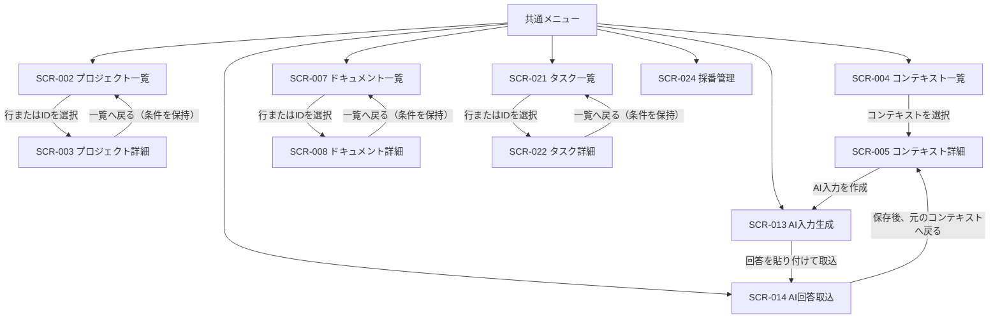

# 管理基盤の画面遷移図

## 1. 対象と前提

画面ID・名称は[画面一覧](./画面一覧.md)に従う。以下はMVPの推奨画面操作であり、要件定義にない項目は本設計の提案として識別する。プロジェクト・タスク・成果物の詳細は、メニューから直接開かず、各一覧で対象を選んで開く。画面IDの採番や全成果物間一意性の実装は採番方針に従い、画面側で独自に採番しない。

## 2. 画面遷移

SCR-003、SCR-022、SCR-008へのメニュー直結は設けない。新規作成はそれぞれの一覧から詳細画面の作成モードを開く。戻る操作はブラウザー履歴だけに依存せず、一覧画面の条件を復元する。

## 3. 一覧・詳細と操作案

以下の絞り込み・表示順・ページサイズは一貫性を優先した初期値の提案であり、要件にある固定値ではない。ページサイズは20件とし、空結果・読込状態も一覧内に表示する。

| 画面 | 初期表示・絞り込み | 並び順・ページング | 登録・詳細への遷移 |
| --- | --- | --- | --- |
| SCR-002 プロジェクト一覧 | 名前・IDのキーワード、状態（全件を初期値） | 名前の昇順、ID昇順を同名時の順序に使用。20件/ページ | 「新規プロジェクト」でSCR-003の作成モード。行またはID選択で対象のSCR-003を開く |
| SCR-021 タスク一覧 | プロジェクト、状態、優先度、ID・タイトルのキーワード。プロジェクト未設定も選択可能 | ID昇順、20件/ページ | 「新規タスク」でSCR-022の作成モード。行またはID選択で対象のSCR-022を開く |
| SCR-007 ドキュメント一覧 | ID・タイトルのキーワード、種別、パス配下。初期値は管理対象として登録済みの成果物 | 更新日時の降順。更新日時がない既存データはID昇順。20件/ページ | 行またはID選択で対象のSCR-008を開く。登録・ファイル取込はこのタスクの画面操作として追加しない |

検索条件とページはURLに反映し、詳細から一覧へ戻るときと再読み込み後に復元する。条件変更時は1ページ目に戻す。検索・絞り込みはサーバー側で適用し、総件数と現在ページを表示する。空の検索結果は「該当するデータがありません」と示し、全件削除などの副作用は起こさない。

### SCR-003 プロジェクト詳細

- 閲覧・編集・作成を同じ詳細画面で扱う。新規・編集時は「保存」「キャンセル」、閲覧時は「編集」「一覧へ戻る」を表示する。
- Projectモデルの`id`、`name`、`description`、`status`を表示する。IDは既存の採番規則で発行し、編集不可とする。名前を必須、説明を任意とする。状態の語彙が未確定の間は未知の状態値も表示・保持し、暗黙の選択肢に置換しない。
- プロジェクトに属するタスク・成果物の件数を表示し、利用可能なら対応する一覧へプロジェクト条件を引き継いで移動する。プロジェクト詳細で関連タスクや成果物そのものを編集しない。
- 保存成功後は同じプロジェクト詳細の閲覧モードを表示する。キャンセルは破棄確認を行い、一覧へ戻る際は検索条件・ページを復元する。

### SCR-022 タスク詳細

- 作成・編集・参照を同じ詳細画面で扱う。Taskモデルの`id`、`title`、`description`、`status`、`priority`、`source`にProjectとの関連を加えて表示する。IDと`source`は自動・取込情報として読み取り専用、タイトルを必須、説明を任意とする。
- 新規タスクではProjectを必須選択とする。既存の未関連タスクは一覧で「プロジェクト未設定」と明示し、編集時に関連付けを選べるようにする。元データを暗黙に特定プロジェクトへ割り当てない。
- 状態は既存の`TODO`、`DOING`、`DONE`のみを使用する。遷移は`TODO → DOING → DONE`を基本とし、完了後の再開は`DONE → DOING`を許す。状態変更は明示的な保存操作で反映する。
- 優先度は既存の`LOW`、`NORMAL`、`HIGH`を使用する。保存成功後は閲覧モードへ戻り、キャンセルと一覧復帰には未保存変更の確認を行う。

### SCR-008 ドキュメント詳細

- ID、タイトル、種別、パス、出典、本文を表示する。既存の成果物ファイルを対象とし、任意パスの新規ファイル作成はこのフローに含めない。
- 読取専用を既定とし、「編集」で明示的に編集モードへ切り替える。保存時は登録済みの対象パスだけを書き換え、成功後に閲覧モードへ戻る。保存失敗時は編集内容を保持してエラーを表示する。
- 「一覧へ戻る」はSCR-007の絞り込み・ページを復元する。未保存変更があれば、保存、破棄、編集継続のいずれかを選ぶ確認を表示する。

### SCR-024 採番管理

- 採番対象のPREFIX、現在の採番状況、既存IDの重複・欠番などの検査結果を参照する管理画面とする。検査結果は読み取り専用とし、該当レコードへの参照が可能な場合のみリンクする。
- 「次のIDを予約・発行」する操作や番号の直接編集は、PREFIXの適用範囲、全成果物間の一意性、並行発行時の排他制御が確定し、中央採番が実装されるまで提供しない。IDの重複を避けるために画面ごとにカウンターを持たない。
- 本タスク群では他画面からSCR-024へ自動遷移させない。プロジェクト・タスク作成時のID発行連携は採番設計・実装タスクで確定する。既存資料から確定できないPREFIXや採番値は未確定として表示する。

## 4. コンテキストからAI回答取込まで

- SCR-004でコンテキストを選択し、SCR-005を開く。SCR-005では選択中のコンテキストIDを画面状態に保持する。
- SCR-005の「AI入力を作成」でSCR-013へ遷移し、コンテキストIDとそのコンテキストに登録済みの関連情報を渡す。SCR-013は入力内容をプレビューし、利用者が明示的にコピーまたは出力する。外部AIサービスを自動実行しない。
- SCR-013からSCR-014へはコンテキストIDと利用者が作成した入力の参照を引き継ぐ。SCR-014ではAI回答を利用者が貼り付け、対象成果物を明示してから検証・保存する。対象を一意に決められない場合は保存を止め、成果物選択を求める。
- 保存後は元のコンテキストが識別できる場合にSCR-005へ戻る。キャンセル時も元画面へ戻る。コンテキストIDがない状態でSCR-013/014を直接開いた場合は、既存の手動選択を促し、推測で関連付けない。

## 5. エラー・未登録ID・未保存変更

- 詳細画面に必要なIDがない場合は、データを推測せず「対象IDが指定されていません」と表示し、該当一覧へ戻る操作を提供する。
- 指定IDが未登録の場合は「対象が見つかりません」と対象IDを表示し、一覧へ戻る操作を提供する。別レコードへのフォールバックや空データでの編集を行わない。
- 読込・保存に失敗した場合はエラーを明示し、再試行と一覧へ戻る操作を提供する。保存失敗時は入力内容を保持する。通信エラーを成功として扱わない。
- 編集中に画面遷移・キャンセル・再読み込みを行う場合、未保存変更があれば明示的な破棄確認を行う。誤った一覧条件で復帰しないよう、戻り先をURL上の一覧条件から復元する。

## 6. 既存要件で確定していない事項

検索項目、ページサイズ20件、ソートの既定値、プロジェクト状態の値、採番管理での発行権限・排他制御、成果物の保存対象範囲、およびAI回答と成果物の対応付けは、本図で提案するMVPの設計判断であり、既存要件の確定事項ではない。これらを製品仕様として固定する場合は、画面・データモデル・採番要件のレビューで合意し、該当要件を更新する。
